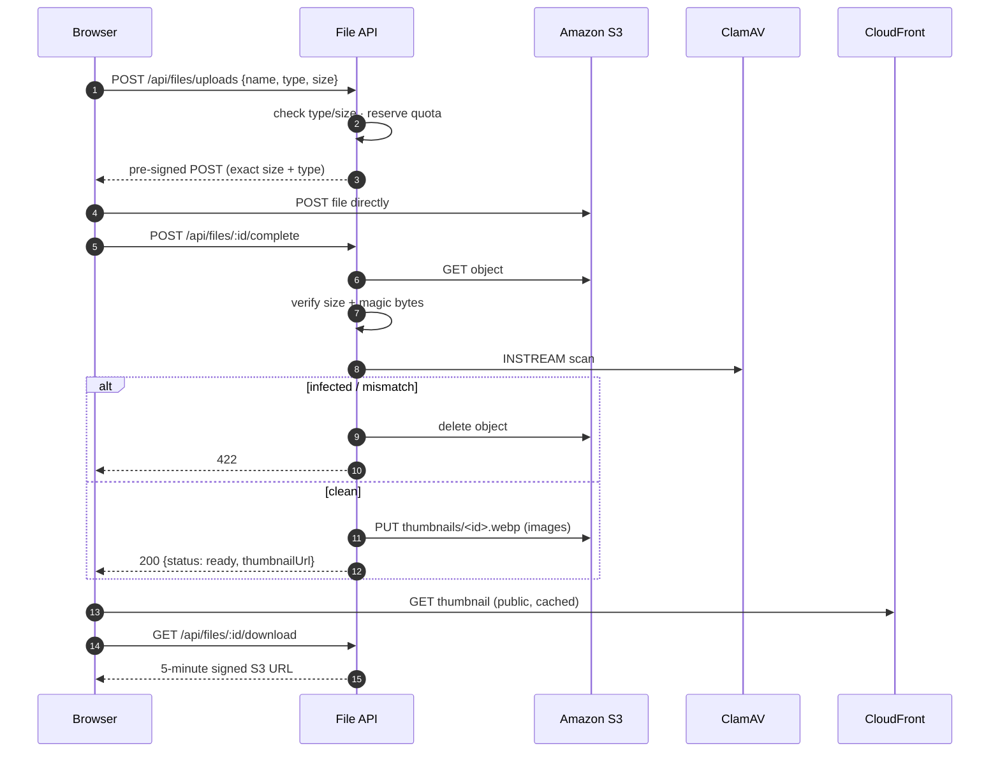
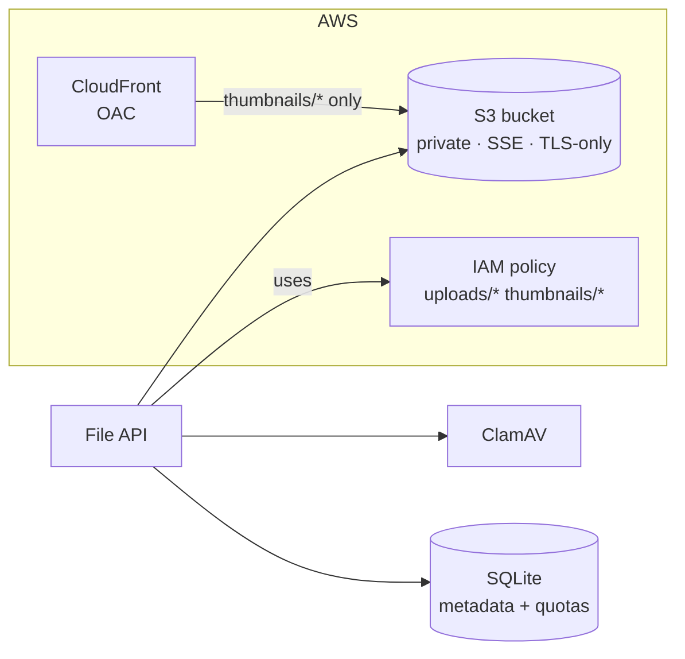

# AWS S3 File Manager

[](https://github.com/CH88320B/aws-s3-file-manager/actions/workflows/ci.yml)


A secure file management service on **AWS S3**, built with Node.js and Express. Browsers upload **directly to S3** with pre-signed URLs, so file bytes never pass through the API. After upload, each file is:

- **Verified** (exact size and magic bytes)
- **Virus-scanned with ClamAV**
- **Thumbnailed with Sharp** (images only)
- Counted against **per-user quotas**

Thumbnails are served through **CloudFront**. Originals stay private and are only reachable through short-lived signed links.

## Features

- **Pre-signed POST uploads**:
  - S3 enforces the exact `content-length-range` and `Content-Type`, so clients can't upload more than they declared
  - Object keys are server-generated (`uploads/<user>/<uuid>`), which rules out path traversal and filename leaks
- **Upload verification**: size check, plus content type detected from magic bytes, so a renamed `.exe` is rejected as a `.png`
- **Virus scanning** via the `clamd` INSTREAM protocol. Infected files are deleted immediately and reported
- **Automatic thumbnails**: EXIF-rotated, max 320px, WebP, cached immutably on CloudFront
- **Per-user quotas**:
  - Space is reserved atomically when an upload is *requested*, so parallel uploads can't overshoot
  - Abandoned uploads are swept and their quota released
- **Download, list (with search), delete**: downloads use 5-minute signed URLs with `Content-Disposition: attachment`
- **Terraform**:
  - Private encrypted bucket with CORS and lifecycle rules
  - CloudFront with Origin Access Control, readable for `thumbnails/*` only
  - TLS-only bucket policy and a least-privilege IAM policy for the app
- **Local stack** with MinIO (S3 compatible) and ClamAV in Docker Compose

## Architecture





## Getting started

### Local (MinIO + ClamAV)

```bash
docker compose up -d minio create-bucket clamav   # ClamAV takes ~1 min to load signatures
cp .env.example .env                               # set S3_ENDPOINT=http://localhost:9000, AWS keys minioadmin
npm install
npm run dev
```

### AWS

```bash
cd terraform
terraform init
terraform apply -var='allowed_origins=["https://app.example.com"]'
```

Put the `bucket` and `cloudfront_url` outputs in `.env`, and attach `app_policy_arn` to the role the service runs as.

### Tests

```bash
npm test
```

## API

All endpoints need `Authorization: Bearer <JWT>` (the `sub` claim is the user id).

| Method | Endpoint | Description |
|--------|----------|-------------|
| `POST` | `/api/files/uploads` | Request an upload `{name, contentType, size}` → pre-signed POST |
| `POST` | `/api/files/:id/complete` | Verify, scan, thumbnail and publish the uploaded file |
| `GET` | `/api/files?search=&limit=&offset=` | List ready files |
| `GET` | `/api/files/:id/download` | Short-lived download URL |
| `DELETE` | `/api/files/:id` | Delete the file and its thumbnail |
| `GET` | `/api/usage` | `{used, limit, available}` in bytes |

Browser upload example:

```js
const { id, upload } = await api.post('/api/files/uploads', { name: file.name, contentType: file.type, size: file.size });
const form = new FormData();
Object.entries(upload.fields).forEach(([k, v]) => form.append(k, v));
form.append('file', file);                       // must be the last field
await fetch(upload.url, { method: 'POST', body: form });
const ready = await api.post(`/api/files/${id}/complete`);
```

## License

[MIT](LICENSE)
